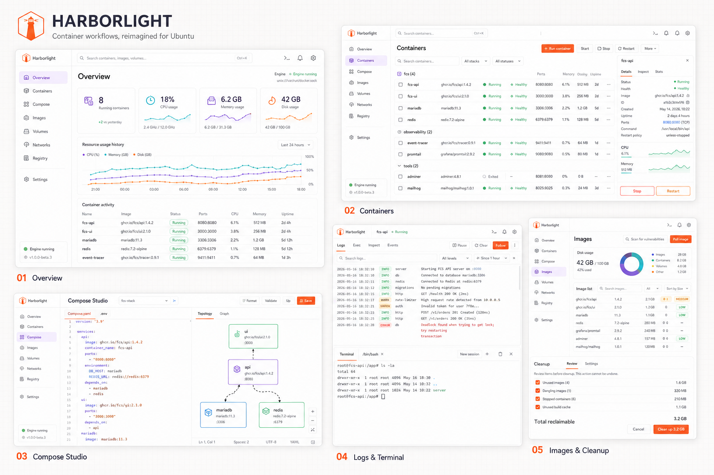
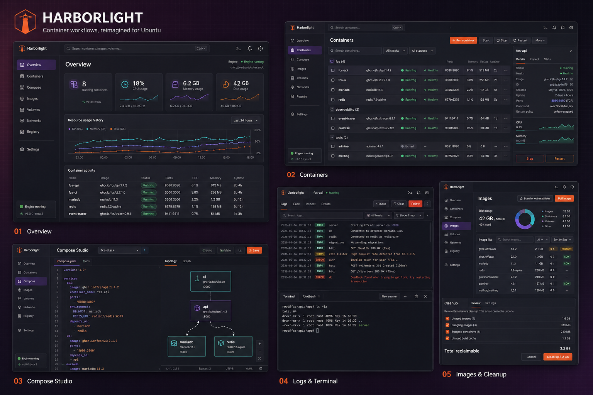

# Harborlight

**Container workflows, reimagined for Ubuntu.**

Harborlight is a desktop application for managing a local Docker Engine on Ubuntu. It shows your
containers, Compose projects, images, volumes and networks the way a desktop app should: live data,
readable states, honest errors, and a confirmation before anything is destroyed.

It is built with Electron, TypeScript and React, ships as a `.deb` and an AppImage, and talks to
Docker through the Engine API over a Unix socket. There is no daemon of its own, no telemetry, and
no background service — when Harborlight is closed, nothing of it is running except the tray icon
you asked for.





## What it does

| Area                   | What you get                                                                                                                                                        |
| ---------------------- | ------------------------------------------------------------------------------------------------------------------------------------------------------------------- |
| **Overview**           | Running/stopped counts, CPU, memory and disk at a glance, 24-hour usage history, recent container activity.                                                         |
| **Containers**         | List and card views, grouping by Compose stack, search and filters, start/stop/restart/pause/kill/rename/remove, run a new container from an image, bulk actions.   |
| **Logs**               | Follow mode, tail size, level filtering, plain-text or regular-expression search with highlighting, pause, clear, export to a file.                                 |
| **Terminal**           | A real interactive shell inside a container (`xterm.js` over the Docker exec API) with TTY resizing and shell fallback.                                             |
| **Compose Studio**     | Discovery of Compose projects, a YAML editor with linting, a service topology graph, and up/down/start/stop/restart/pull/build with a preview of the exact command. |
| **Images**             | Disk usage breakdown, pull with live progress, tag, inspect, history, remove, optional Trivy vulnerability scan.                                                    |
| **Cleanup**            | A planner that lists exactly what will be removed and how much space it frees, with a dry run and a typed confirmation for anything that loses data.                |
| **Volumes & Networks** | Listing, filtering, inspection and guarded removal, including in-use detection.                                                                                     |
| **Registry**           | Add registries, log in and out, credentials stored through the OS keyring (Electron `safeStorage`).                                                                 |
| **Settings**           | Theme, tray glyph, Docker socket, polling interval, log defaults, terminal shell, tray/autostart behaviour, update channel, destructive-action confirmations.       |

Everything above operates on real Docker resources. Nothing in the UI reports success without having
performed the operation.

## Supported systems

| Requirement  | Supported                                                                       |
| ------------ | ------------------------------------------------------------------------------- |
| Distribution | Ubuntu 22.04, 24.04 and 26.04 LTS                                               |
| Architecture | x86_64 (amd64) and arm64                                                        |
| Session      | Wayland and X11 (GNOME tested)                                                  |
| Docker       | Docker Engine 20.10 or newer, rootful or rootless                               |
| Compose      | Docker Compose v2 (`docker compose`) — optional, needed only for Compose Studio |

Other distributions are not tested. Both the installer and the application will tell you and let you
continue with `--force-unsupported`.

## Prerequisites

For **using** a packaged build:

```bash
sudo apt-get install docker.io          # or Docker's own packages
sudo systemctl enable --now docker
```

Your user needs access to the Docker socket. Harborlight never changes socket permissions for you;
see [docs/INSTALLATION.md](docs/INSTALLATION.md#docker-socket-permissions) for the options and their
security trade-offs.

For **building from source**, additionally:

- Node.js 20 LTS (the version is pinned in `.nvmrc`) and npm 10+
- `make`, `python3` (icon generation), `dpkg-deb` and `fakeroot` (Debian packaging)

## Quick start

```bash
git clone https://github.com/fmussad/Harborlight.git
cd Harborlight

make bootstrap        # install dependencies
make dev              # start the development session
make stop             # stop it again
```

To install the application onto your system from this checkout:

```bash
make install          # builds the .deb and installs it (asks before anything privileged)
harborlight           # or launch "Harborlight" from the Ubuntu application menu
harborlight --version
```

No Docker Engine available? Run the whole app against an in-memory mock:

```bash
make dev MOCK=1
```

## Everyday commands

| Command                            | What it does                                                                                          |
| ---------------------------------- | ----------------------------------------------------------------------------------------------------- |
| `make help`                        | List every target and variable.                                                                       |
| `make dev`                         | Start Vite plus Electron in the background, recording its process group in `.harborlight/dev.pid`.    |
| `make logs`                        | Follow `.harborlight/dev.log`.                                                                        |
| `make stop`                        | Stop exactly the session `make dev` started. Never touches other Electron processes.                  |
| `make doctor`                      | Check Ubuntu version, architecture, Docker, socket permissions, Compose, desktop entry and autostart. |
| `make check`                       | `lint` + `typecheck` + `test`.                                                                        |
| `make test-e2e`                    | Playwright end-to-end suite against a real Electron build.                                            |
| `make package`                     | Build `.deb` and AppImage for amd64 and arm64 into `dist/`.                                           |
| `make install`                     | Package, then install through `install.sh`.                                                           |
| `make uninstall`                   | Remove Harborlight, keeping your settings.                                                            |
| `make publish VERSION=… CHANNEL=…` | Build, verify and assemble a release.                                                                 |

## Autostart

Install and start at login, hidden in the tray:

```bash
make install INSTALL_ARGS="--autostart --start-minimized --launch"
```

This writes `~/.config/autostart/harborlight.desktop`:

```ini
[Desktop Entry]
Type=Application
Name=Harborlight
Comment=Container workflows, reimagined for Ubuntu
Exec=/usr/local/bin/harborlight --hidden
Icon=harborlight
Terminal=false
X-GNOME-Autostart-enabled=true
```

You can also toggle it later from **Settings → Desktop → Start at login**. To remove it:

```bash
./install.sh install --no-autostart      # or simply delete the file above
```

## Troubleshooting the first five minutes

| Symptom                                    | First thing to try                                                                                                                                                                                           |
| ------------------------------------------ | ------------------------------------------------------------------------------------------------------------------------------------------------------------------------------------------------------------ |
| "Cannot connect to the Docker Engine"      | `make doctor`. It reports whether the socket exists and whether your user can use it.                                                                                                                        |
| `permission denied … /var/run/docker.sock` | Add yourself to the `docker` group (root-equivalent access) with `sudo usermod -aG docker "$USER"` and log out and back in, or switch to rootless Docker and set the socket in **Settings → Docker Engine**. |
| Rootless Docker not detected               | Set the socket to `/run/user/$(id -u)/docker.sock` in **Settings → Docker Engine**, or start Harborlight after `systemctl --user start docker`.                                                              |
| Compose Studio is read-only                | Install Compose v2: `sudo apt-get install docker-compose-v2`.                                                                                                                                                |
| Tray icon missing on GNOME                 | Install the AppIndicator extension: `sudo apt-get install gnome-shell-extension-appindicator` and enable it.                                                                                                 |
| App does not start after installing        | Run `harborlight` from a terminal — startup problems are printed there and written to `~/.config/Harborlight/logs/`.                                                                                         |

Longer answers, including Wayland, the Electron sandbox and diagnostics export, are in
[docs/TROUBLESHOOTING.md](docs/TROUBLESHOOTING.md).

## Documentation

| Document                                               | Contents                                                                                                        |
| ------------------------------------------------------ | --------------------------------------------------------------------------------------------------------------- |
| [docs/ARCHITECTURE.md](docs/ARCHITECTURE.md)           | Process boundaries, typed IPC, engine adapters, Compose execution, state, packaging, diagrams.                  |
| [docs/DEVELOPMENT.md](docs/DEVELOPMENT.md)             | Clone to running app, mock mode, logs, tests, adding a Docker operation, debugging each process.                |
| [docs/INSTALLATION.md](docs/INSTALLATION.md)           | Every `install.sh` command and flag, socket permissions, rootless Docker, autostart, upgrade, uninstall, purge. |
| [docs/DOCKER_OPERATIONS.md](docs/DOCKER_OPERATIONS.md) | Every Docker and Compose operation Harborlight performs, and the exact API call or command behind it.           |
| [docs/SECURITY.md](docs/SECURITY.md)                   | Threat model, Electron hardening, IPC allowlist, secret storage, destructive-action safeguards.                 |
| [docs/TESTING.md](docs/TESTING.md)                     | Test layout, what each suite covers, how to run them, and what cannot be automated.                             |
| [docs/PUBLISHING.md](docs/PUBLISHING.md)               | Versioning, release manifests, checksums, providers, dry runs, rollback.                                        |
| [docs/RELEASES.md](docs/RELEASES.md)                   | Release history and upgrade notes.                                                                              |
| [docs/TROUBLESHOOTING.md](docs/TROUBLESHOOTING.md)     | Symptom-first fixes for Docker, desktop and installer problems.                                                 |
| [docs/DECISIONS.md](docs/DECISIONS.md)                 | Architectural decision records, with the alternatives that were rejected.                                       |
| [CONTRIBUTING.md](CONTRIBUTING.md)                     | Workflow, coding standards, commit and pull-request expectations.                                               |

## Security in one paragraph

Anything that can reach the Docker socket can control the host. Harborlight therefore keeps all
Docker access in the Electron main process; the renderer is sandboxed, context-isolated, has no
Node.js integration, and can only call an explicit allowlist of commands whose payloads are
validated with Zod. External commands are spawned as argument arrays with `shell: false`. Registry
credentials go to the OS keyring through `safeStorage`, never to a plain-text file. Destructive
operations always show what will be removed and require confirmation. Details and the full threat
model are in [docs/SECURITY.md](docs/SECURITY.md).

## License

MIT — see [LICENSE](LICENSE).
