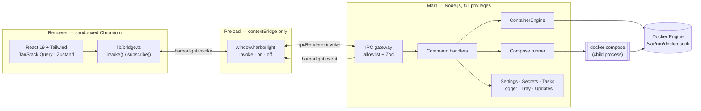
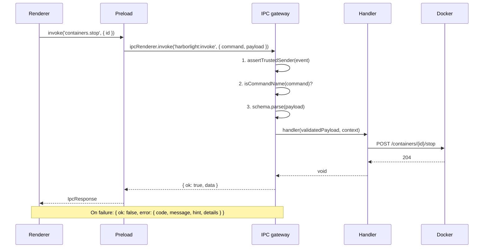
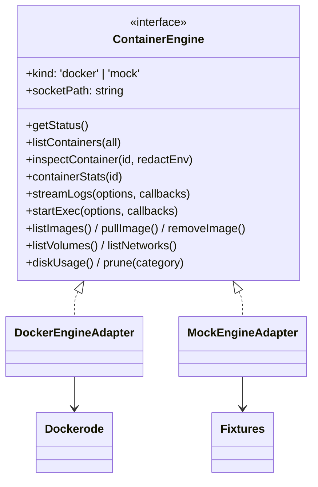
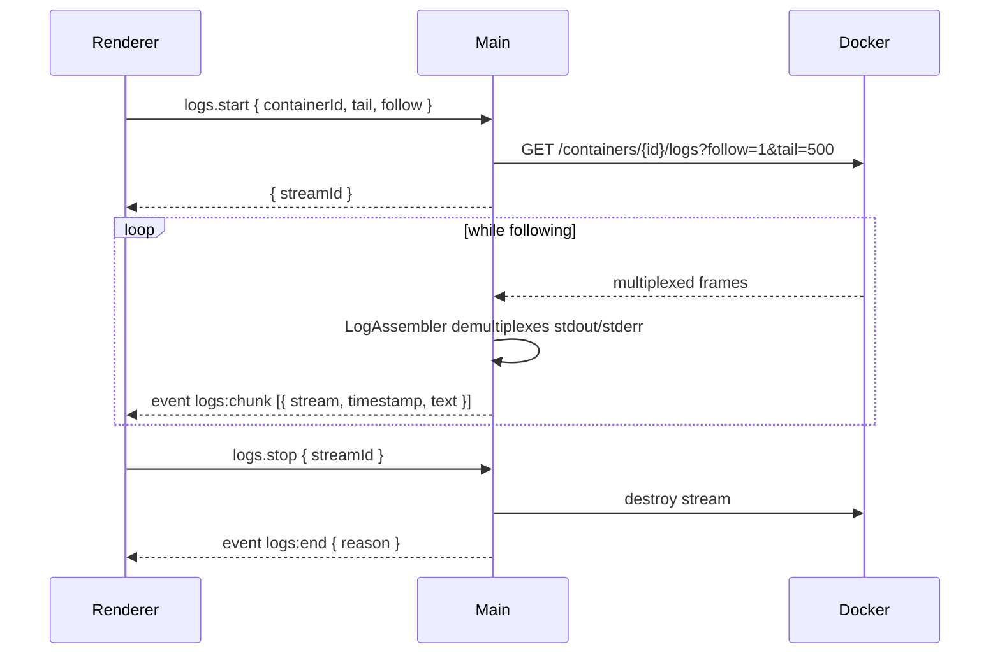
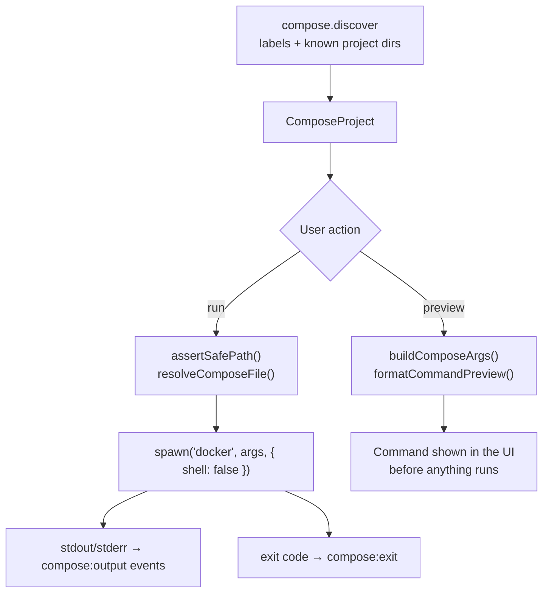
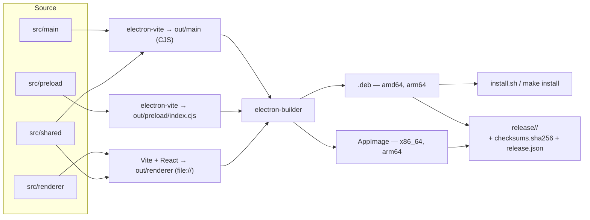

# Architecture

Harborlight is an Electron application with three processes and one rule that shapes everything
else: **only the main process may talk to Docker.** The renderer is a sandboxed web application that
can ask for work through a narrow, validated channel and receive events back. If you keep that
boundary in mind, the rest of the codebase follows naturally.

## Contents

- [Process boundaries](#process-boundaries)
- [Typed IPC](#typed-ipc)
- [The container engine abstraction](#the-container-engine-abstraction)
- [Streaming: logs and terminals](#streaming-logs-and-terminals)
- [Compose execution](#compose-execution)
- [Background tasks](#background-tasks)
- [State management in the renderer](#state-management-in-the-renderer)
- [Security boundaries](#security-boundaries)
- [Settings, secrets and files on disk](#settings-secrets-and-files-on-disk)
- [Build and packaging](#build-and-packaging)
- [Directory map](#directory-map)

## Process boundaries



| Process  | Entry point             | May use                                                         | Never uses                                             |
| -------- | ----------------------- | --------------------------------------------------------------- | ------------------------------------------------------ |
| Main     | `src/main/index.ts`     | Node.js, Electron main APIs, the Docker socket, child processes | DOM APIs                                               |
| Preload  | `src/preload/index.ts`  | `contextBridge`, `ipcRenderer` on two channels                  | Node modules beyond what it re-exports, business logic |
| Renderer | `src/renderer/main.tsx` | DOM, React, `window.harborlight`                                | Node.js, `require`, `fs`, Dockerode, `child_process`   |

`src/shared/` is the only code imported by more than one process. It holds Zod schemas, the command
contract, formatting helpers and the Compose YAML parser — all of it pure and free of Node.js and
DOM dependencies.

## Typed IPC

There are exactly two IPC channels (`src/shared/contracts/channels.ts`):

| Channel              | Direction                          | Purpose                                                               |
| -------------------- | ---------------------------------- | --------------------------------------------------------------------- |
| `harborlight:invoke` | renderer → main (request/response) | Every command.                                                        |
| `harborlight:event`  | main → renderer (one-way)          | Engine status, log chunks, exec output, task and notification events. |

A command is a key of `commandSchemas` in `src/shared/contracts/commands.ts`. That object is
simultaneously the allowlist, the payload validator and the source of the TypeScript types:

```ts
export const commandSchemas = {
  'containers.stop': containerRef.extend({
    timeoutSeconds: z.number().int().min(0).max(600).default(10)
  })
  // …
} as const

export type CommandName = keyof typeof commandSchemas
export type CommandPayload<K extends CommandName> = z.output<(typeof commandSchemas)[K]>
```

Results are typed per command in `src/shared/contracts/responses.ts` (`CommandResult<K>`), so
`invoke('containers.list', { all: true })` is statically known to resolve to `ContainerSummary[]`.

### Request lifecycle



Three properties fall out of this design:

1. **A command that is not in the allowlist never reaches a handler.** It is rejected with
   `not-allowed` before any Docker code runs.
2. **Handlers only see validated data.** Defaults, ranges and formats (image references, absolute
   paths, container names) are enforced by the schema, not by hand-written checks.
3. **Errors keep their structure.** Electron flattens thrown `Error` objects across the context
   bridge, so the gateway returns a plain `{ ok, data | error }` envelope instead. The renderer's
   `invoke()` wrapper rethrows it as a `UiError` carrying `code`, `message`, `hint` and `details`,
   which is what lets the UI show "Add your user to the docker group" instead of "EACCES".

Error codes (`src/main/errors.ts`): `engine-unavailable`, `permission`, `not-found`, `conflict`,
`validation`, `not-allowed`, `cancelled`, `timeout`, `unknown`.

## The container engine abstraction

Nothing above `src/main/docker/engine.ts` knows that Dockerode exists. The `ContainerEngine`
interface describes the ~35 operations Harborlight needs, in Harborlight's own vocabulary:



- **`DockerEngineAdapter`** wraps Dockerode over a Unix socket and immediately normalizes every
  response through `src/main/docker/normalize.ts`. Raw Docker payloads never leave this file:
  states become a closed union, health becomes `healthy | unhealthy | starting | none`, CPU deltas
  become a percentage, Compose labels become `composeProject` / `composeService`.
- **`MockEngineAdapter`** serves deterministic fixtures from `src/shared/mock/fixtures.ts`, including
  a synthetic log stream and a fake shell. It backs `make dev MOCK=1`, the E2E suite and screenshots.
  Selecting it is explicit — `HARBORLIGHT_ENGINE=mock` or **Settings → Docker Engine → mock** — and
  the sidebar shows a "Mock engine" badge so a demo can never be mistaken for a real host.

`EngineManager` (`src/main/services/engineManager.ts`) owns the active adapter. It polls
`getStatus()` on the configured interval, emits `engine:status` only when something actually
changed, aggregates per-container stats into host-level `UsageSample`s every 15 seconds for the
Overview charts (bounded to 8 concurrent stats calls and 64 containers), persists that history to
`usage-history.json`, and caches the expensive `docker df` result for five minutes.

## Streaming: logs and terminals

Request/response is a poor fit for logs and shells, so both use the event channel with a
main-process registry (`src/main/streams.ts`) that guarantees teardown.



- Docker's log stream is 8-byte-framed when there is no TTY. `LogAssembler`
  (`src/main/docker/logFrames.ts`) buffers partial frames and splits stdout from stderr correctly,
  which is why a line never appears cut in half.
- Chunks are batched before crossing IPC, and the renderer keeps a bounded ring buffer
  (`useLogStream`), so a container that logs in a loop cannot grow memory without limit.
- Exec sessions are the same idea in both directions: `exec.start` returns a `sessionId`,
  `exec.write` sends keystrokes, `exec.resize` follows the xterm.js viewport, `exec.data` and
  `exec.exit` come back as events. The adapter tries the configured shell and then falls back
  through a candidate list (`bash`, `sh`, `ash`) so distroless-ish images still open.
- Every handle is registered in `streams`. `window-all-closed` and `will-quit` call `stopAll()`, so
  no stream can outlive the window that opened it.

## Compose execution

Compose is the one place where Harborlight shells out, because `docker compose` implements
dependency ordering, profiles and build semantics that the Engine API does not expose.



Rules enforced in `src/main/compose/`:

- **Never a shell string.** `buildComposeArgs()` returns an argument array; `spawn` is called with
  `shell: false`. Command injection through a project name or service name is not possible.
- **Paths are validated twice.** The Zod schema requires an absolute path with no `..` and a
  Compose-shaped filename; `paths.ts` then re-resolves it and asserts the file lives inside the
  working directory.
- **Destructive actions are labelled.** `isDestructiveAction()` and `requiresVolumeConfirmation()`
  drive the confirmation dialog, and `compose.action` refuses to run a destructive action unless the
  caller passed `confirmedDestructive: true`.
- **The exact command is shown first.** `compose.preview` returns the string the runner would
  execute, so nothing happens that you did not read.

The YAML editor uses the shared parser (`src/shared/compose/parse.ts`) for structure, lint warnings
and the topology graph, and `docker compose config` for real validation when Compose is installed.

## Background tasks

Image pulls, Compose runs, cleanup and scans register with `TaskRegistry`
(`src/main/services/tasks.ts`). Each task exposes `progress()`, `succeed()`, `fail()` and an
`AbortSignal`, and every change is broadcast as a `task:update` event. The renderer renders them in
the notification popover with a progress bar and, when the task is cancellable, a cancel button that
sends `system.cancelTask`. Finished tasks are trimmed to the last 40.

## State management in the renderer

| Concern      | Tool                     | Notes                                                                                                                                  |
| ------------ | ------------------------ | -------------------------------------------------------------------------------------------------------------------------------------- |
| Server state | TanStack Query           | One hook per resource in `lib/queries.ts`, polling intervals from settings, cache invalidated by mutations and by main-process events. |
| UI state     | Zustand (`stores/ui.ts`) | Selected section, filters, view mode, selection, open panels. Persisted where it makes sense.                                          |
| Settings     | Main process             | The renderer never owns settings; it reads them through `settings.get` and reacts to `settings:changed`.                               |
| Transient UI | React state              | Dialog fields, editor buffers, terminal focus.                                                                                         |

`AppProviders` also runs an `EventBridge` that turns main-process events into query invalidations and
toasts, so an action taken in the tray menu or a change made in another window is reflected
immediately.

## Security boundaries

```mermaid
flowchart LR
    subgraph Untrusted["Renderer — treated as untrusted"]
        direction TB
        S1["sandbox: true"]
        S2["contextIsolation: true"]
        S3["nodeIntegration: false"]
        S4["CSP: default-src 'none'\nno unsafe-eval"]
        S5["will-navigate blocked\nwindow.open denied\nwebview blocked\npermissions denied"]
    end
    subgraph Trusted["Main — privileged"]
        T1["Sender frame check"]
        T2["Command allowlist"]
        T3["Zod payload validation"]
        T4["spawn(argv, shell: false)"]
        T5["safeStorage for secrets"]
        T6["Confirmation for destructive work"]
    end
    Untrusted -->|"two channels only"| Trusted --> Docker[("Docker socket")]
```



The full rationale, including what Harborlight deliberately does _not_ do (change socket
permissions, run as root, add APT repositories), is in [SECURITY.md](SECURITY.md).

## Settings, secrets and files on disk

| Path                                       | Contents                                                                                                                                                                                                                                                                                           |
| ------------------------------------------ | -------------------------------------------------------------------------------------------------------------------------------------------------------------------------------------------------------------------------------------------------------------------------------------------------- |
| `~/.config/Harborlight/settings.json`      | User settings, validated with `settingsSchema` on read; invalid or partial files fall back to defaults instead of crashing.                                                                                                                                                                        |
| `~/.config/Harborlight/registries.json`    | Registry metadata plus credentials encrypted with Electron `safeStorage` (GNOME Keyring / libsecret), written atomically with mode `0600`. Plaintext never reaches disk, the renderer or the logs; if no OS keyring is available Harborlight refuses to store credentials rather than downgrading. |
| `~/.config/Harborlight/usage-history.json` | Host CPU/memory/disk samples for the Overview charts.                                                                                                                                                                                                                                              |
| `~/.config/Harborlight/logs/`              | Application logs, level from `HARBORLIGHT_LOG_LEVEL`.                                                                                                                                                                                                                                              |
| `~/.config/autostart/harborlight.desktop`  | Written only when autostart is enabled.                                                                                                                                                                                                                                                            |

## Build and packaging



- **electron-vite** builds all three bundles with the same TypeScript path aliases (`@shared/*`,
  `@main/*`, `@renderer/*`) and emits CommonJS for main and preload, ESM for the renderer.
- Heavy renderer dependencies (CodeMirror, React Flow, xterm.js) are lazily imported so the initial
  bundle stays small and the terminal only loads when a terminal is opened.
- **electron-builder** (`electron-builder.yml`) produces `.deb` and AppImage for both architectures.
  The `.deb` declares real runtime dependencies, recommends `docker.io`, and ships `postinst` /
  `postrm` scripts that fix the `chrome-sandbox` SUID bit and refresh the desktop and icon caches.
- Build metadata (version, Git SHA, channel, build date) is injected into `src/main/build-info.ts`
  at build time and surfaced by `harborlight --version` and **Settings → About**.

## Directory map

```text
src/
  main/
    index.ts              app lifecycle, single instance, root and platform guards
    ipc/registry.ts       the invoke gateway: sender check, allowlist, validation
    ipc/handlers/         one module per command family
    docker/               engine interface, Docker + mock adapters, normalization,
                          log framing, socket discovery, command tokenizer
    compose/              discovery, argument building, path safety, runner
    services/             settings, secrets, engine manager, tasks, events, logger,
                          autostart, cleanup, updates, trivy, os-release
    tray/  windows/       tray menu, BrowserWindow creation and hardening
  preload/index.ts        contextBridge surface (invoke, on, off)
  renderer/
    pages/                Overview, Containers, Compose, Images, Volumes, Networks,
                          Registry, Settings
    components/           layout, ui primitives, containers, images, compose
    lib/                  bridge, queries, log stream hook, engine helpers
    stores/ui.ts          Zustand UI state
  shared/
    contracts/            channels, commands (allowlist + schemas), responses, api
    schemas/domain.ts     normalized domain types
    compose/parse.ts      YAML parsing, project extraction, linting
    utils/                formatting, redaction
    mock/fixtures.ts      deterministic demo data
tests/    unit · renderer · e2e
scripts/  dev.sh · stop.sh · publish.sh · write-manifest.mjs · generate-icons.py
build/    deb/postinst · deb/postrm · license.txt
```
