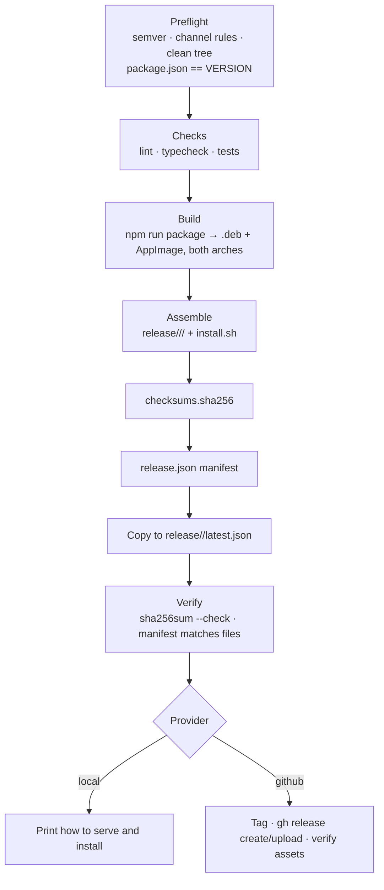

# Publishing

A Harborlight release is a directory of artifacts, a checksum file and a manifest. `make publish`
builds it, verifies it, and optionally uploads it. The same manifest is what `install.sh
--source release` reads to install and what the in-app update check reads to tell you a new version
exists.

## Contents

- [Versioning policy](#versioning-policy)
- [Prerequisites](#prerequisites)
- [Publishing a release](#publishing-a-release)
- [What `make publish` does](#what-make-publish-does)
- [Release layout](#release-layout)
- [The manifest](#the-manifest)
- [Checksums](#checksums)
- [Providers](#providers)
- [How `install.sh --source release` finds a version](#how-installsh---source-release-finds-a-version)
- [Update checks](#update-checks)
- [Verifying a release](#verifying-a-release)
- [Rollback](#rollback)
- [Release checklist](#release-checklist)

## Versioning policy

Harborlight uses [semantic versioning](https://semver.org): `MAJOR.MINOR.PATCH`, with optional
prerelease suffixes such as `0.2.0-beta.1`.

| Change                                                                       | Bump  |
| ---------------------------------------------------------------------------- | ----- |
| Breaking change to the IPC contract, settings file format or installer flags | major |
| New feature, new command, new page                                           | minor |
| Bug fix, performance, documentation, dependency bump                         | patch |

Rules the tooling enforces:

- `package.json` must already contain the version you are publishing. `scripts/publish.sh` refuses
  to continue on a mismatch, so the version in the repository always matches the artifacts.
- A prerelease version cannot go to the `stable` channel.
- A non-prerelease version on the `beta` channel is allowed but warns.
- The working tree must be clean. Releases are built from committed code only.

Channels are `stable` and `beta`. They are separate directories with separate `latest.json`
pointers, so a beta cannot be offered to users on stable.

## Prerequisites

| Requirement                         | Why                                                       |
| ----------------------------------- | --------------------------------------------------------- |
| Clean Git working tree              | The commit hash is baked into the build and the manifest. |
| `package.json` version == `VERSION` | Prevents mislabelled artifacts.                           |
| Node 20, npm, `make`                | Building.                                                 |
| `dpkg-deb`, `fakeroot`              | Debian packaging.                                         |
| GitHub CLI (`gh`), authenticated    | Only for `PUBLISH_PROVIDER=github`.                       |

No signing keys are required today: artifacts are verified by SHA-256 checksums published alongside
them. GPG or `debsign` signatures are a planned addition — see
[DECISIONS.md](DECISIONS.md#adr-010-release-artifacts-are-verified-by-checksum-not-signature).

## Publishing a release

Always dry-run first:

```bash
make publish VERSION=0.1.0 CHANNEL=stable PUBLISH_DRY_RUN=1
```

Then the real thing:

```bash
make publish VERSION=0.1.0 CHANNEL=stable
```

That produces a complete, verified release directory locally (`PUBLISH_PROVIDER=local`, the
default). To upload it to GitHub:

```bash
make publish VERSION=0.1.0 CHANNEL=stable PUBLISH_PROVIDER=github PUBLISH_TAG=1
```

### Variables

| Variable              | Default                         | Meaning                                                            |
| --------------------- | ------------------------------- | ------------------------------------------------------------------ |
| `VERSION`             | — (required)                    | Semantic version to publish.                                       |
| `CHANNEL`             | `stable`                        | `stable` or `beta`.                                                |
| `PUBLISH_DRY_RUN`     | `0`                             | Describe every step, upload nothing, build nothing.                |
| `PUBLISH_PROVIDER`    | `local`                         | `local` or `github`.                                               |
| `PUBLISH_TAG`         | `0`                             | Create and push the `vX.Y.Z` tag. Required by the GitHub provider. |
| `PUBLISH_DIR`         | `./release`                     | Where the release tree is assembled.                               |
| `PUBLISH_BASE_URL`    | GitHub download URL for the tag | Base URL written into the manifest's artifact URLs.                |
| `PUBLISH_RELEASE_URL` | GitHub release page for the tag | Human-facing release URL in the manifest.                          |
| `PUBLISH_SKIP_CHECKS` | `0`                             | Skip lint, typecheck and tests. For emergencies; it warns loudly.  |

## What `make publish` does



Every step is fail-fast (`set -Eeuo pipefail`). A dry run prints each command it would run instead of
running it, and still tells you what the resulting release would contain.

## Release layout

```text
release/
└── stable/
    ├── latest.json                 # copy of the newest release.json in this channel
    └── 0.1.0/
        ├── harborlight_0.1.0_amd64.deb
        ├── harborlight_0.1.0_arm64.deb
        ├── Harborlight-0.1.0-x86_64.AppImage
        ├── Harborlight-0.1.0-arm64.AppImage
        ├── install.sh
        ├── checksums.sha256
        └── release.json
```

`install.sh` is part of every release so users can install without cloning the repository.

## The manifest

`release.json` (and its copy `latest.json`) is a small, stable document:

```json
{
  "schema": 1,
  "product": "Harborlight",
  "channel": "stable",
  "version": "0.1.0",
  "commit": "9f1c2b0e…",
  "releasedAt": "2026-08-28T04:50:39Z",
  "releaseUrl": "https://github.com/fmussad/Harborlight/releases/tag/v0.1.0",
  "minimumUbuntu": "22.04",
  "architectures": ["amd64", "arm64"],
  "artifacts": [
    {
      "name": "harborlight_0.1.0_amd64.deb",
      "kind": "deb",
      "architecture": "amd64",
      "sha256": "…",
      "url": "https://github.com/fmussad/Harborlight/releases/download/v0.1.0/harborlight_0.1.0_amd64.deb"
    }
  ]
}
```

`schema: 1` is there so a future format change can be detected rather than guessed. Anything reading
the manifest — the installer, the update check, a mirror script — can rely on `version`, `channel`
and the `artifacts` array with its `sha256` values.

## Checksums

`checksums.sha256` is generated with `sha256sum` over every artifact plus `install.sh`, in the
standard format:

```text
b1946ac92492d2347c6235b4d2611184…  harborlight_0.1.0_amd64.deb
```

Verify a download by hand:

```bash
sha256sum --check --ignore-missing checksums.sha256
```

`install.sh --source release` does this automatically and **refuses to install** if the file is
missing or a hash does not match (exit code 7).

## Providers

Publication targets sit behind a small interface, so adding one is a function, not a rewrite.

### `local` (default)

Assembles and verifies the release directory and stops there. Ideal for testing the whole pipeline,
including the update check:

```bash
python3 -m http.server --directory release 8099
HARBORLIGHT_UPDATE_BASE_URL=http://localhost:8099 harborlight
HARBORLIGHT_RELEASE_BASE_URL=http://localhost:8099/stable/0.1.0 ./install.sh install --source release
```

### `github`

Requires `gh` authenticated (`gh auth login`) and `PUBLISH_TAG=1`, because a GitHub release needs a
tag. It creates and pushes `vX.Y.Z` if it does not exist, creates the release (marked prerelease for
the beta channel) or uploads to an existing one with `--clobber`, then lists the uploaded assets to
confirm.

### Adding another provider

Implement a `publish_<name>()` function in `scripts/publish.sh` and add it to the `case` at the
bottom. It receives a fully assembled, verified `RELEASE_DIR` and only has to transfer it.

## How `install.sh --source release` finds a version

1. Detects the architecture (`amd64` or `arm64`).
2. Builds the base URL:
   - without `--version`: `https://github.com/fmussad/Harborlight/releases/latest/download`
   - with `--version 0.1.0`: `…/releases/download/v0.1.0`
   - or `HARBORLIGHT_RELEASE_BASE_URL` when set, which is how you test against a local server.
3. Downloads `harborlight_<version>_<arch>.deb` and `checksums.sha256` over HTTPS with
   `curl --fail --proto '=https' --tlsv1.2`.
4. Verifies the SHA-256, then installs through `apt-get install ./file.deb` so dependencies resolve.
5. Verifies the result by running `harborlight --version`.

## Update checks

The application never downloads or installs an update by itself. `system.checkForUpdates` fetches
`<HARBORLIGHT_UPDATE_BASE_URL>/<channel>/latest.json`, compares `version` with the running version
using a semver-aware comparison, and reports one of:

- "Harborlight X is available. Upgrade with: `./install.sh upgrade --source release --channel …`"
- "Harborlight X is the latest stable release."
- an explanation when no endpoint is configured, the manifest returns an HTTP error, or the network
  is unreachable.

If `HARBORLIGHT_UPDATE_BASE_URL` is unset, the check is a no-op that says so. That is the default:
no build phones home unless you point it at an endpoint.

## Verifying a release

Before announcing it:

```bash
cd release/stable/0.1.0

# 1. Checksums
sha256sum --check checksums.sha256

# 2. Manifest agrees with the files on disk
jq -r '.artifacts[].name' release.json | while read -r f; do test -f "$f" || echo "MISSING $f"; done

# 3. Package metadata
dpkg-deb --info harborlight_0.1.0_amd64.deb
dpkg-deb --contents harborlight_0.1.0_amd64.deb | grep -E 'applications|bin/harborlight'

# 4. Install into a clean VM or container, then
harborlight --version          # version, commit, channel, build date
./install.sh doctor
```

`scripts/publish.sh` runs steps 1 and 2 automatically and aborts if either fails.

## Rollback

Nothing is destroyed by a release, so rolling back is re-pointing and re-installing.

1. **Stop offering the bad version.** Move the channel pointer back:

   ```bash
   cp release/stable/0.1.0/release.json release/stable/latest.json
   ```

   With the GitHub provider, mark the bad release as a prerelease or delete it:

   ```bash
   gh release edit v0.2.0 --prerelease
   gh release delete v0.2.0 --yes        # tag stays unless you also delete it
   ```

2. **Tell users how to go back.** The previous version is still published:

   ```bash
   ./install.sh install --source release --channel stable --version 0.1.0
   ```

   Downgrading is a normal `apt-get install ./file.deb` and keeps `~/.config/Harborlight`, so
   settings and registry logins survive.

3. **Fix forward.** Publish a patch release rather than reusing a version number — a version that
   has been downloaded must never change content, or checksums become meaningless.

## Release checklist

- [ ] `CHANGELOG` section in [RELEASES.md](RELEASES.md) written.
- [ ] `package.json` version bumped and committed.
- [ ] `make check` passes.
- [ ] `make test-e2e` passes on a machine with a display.
- [ ] `make publish VERSION=… CHANNEL=… PUBLISH_DRY_RUN=1` looks right.
- [ ] `make publish VERSION=… CHANNEL=…` succeeds and the verification step passes.
- [ ] Installed the resulting `.deb` on a clean Ubuntu VM; the app starts, connects to Docker and
      reports the expected version and commit.
- [ ] Release notes mention breaking changes and the upgrade command.
